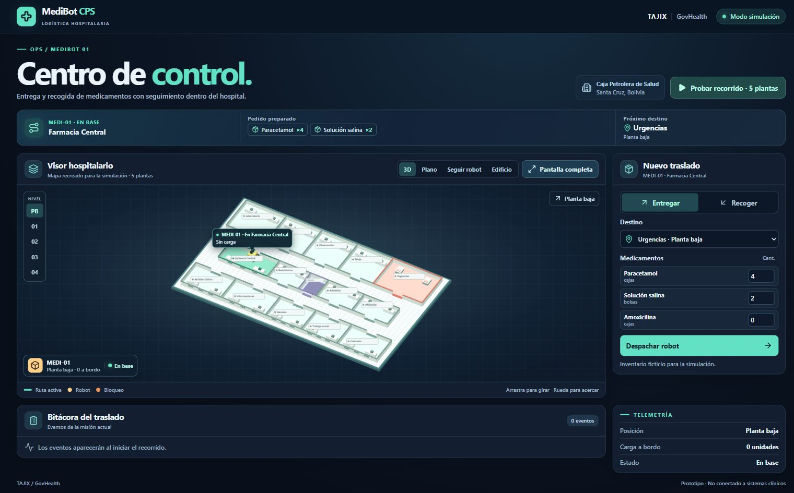
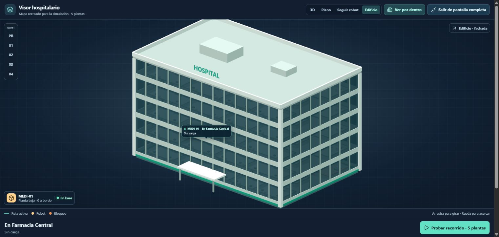
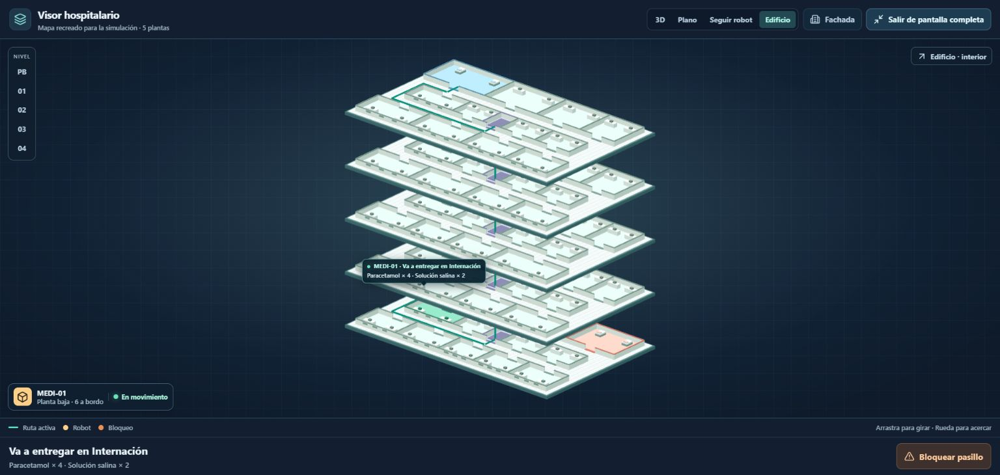

# MediBot CPS · Presentación GovHealth de TAJIX

Guion y guía de uso de la demo integrada. El centro de control representa un hospital recreado de cinco plantas y el catálogo solo contiene medicamentos ficticios. La vista independiente del complejo incorpora tres torres con 13 plantas en total y un recorrido visual automático.

## Guion de tres minutos

**Antes de comenzar:** abre la demo local y verifica WebGL 2. La vista inicial muestra la fachada ilustrativa del hospital. Prepara el modo **Recoger** con destino **Internación · Piso 4**, cuatro cajas de Paracetamol y dos bolsas de Solución salina. Espera para pulsar **Despachar robot**. Ten a mano el PIN `0426`. La demo rápida de cinco plantas programa una entrega, por eso la recogida se configura manualmente.

| Tiempo | Acción y locución |
|---|---|
| 0:00–0:35 | **Contexto.** «Somos TAJIX y presentamos MediBot CPS. Nuestra hipótesis es que automatizar parte del traslado interno de medicamentos puede liberar tiempo del personal para la atención. Construimos una simulación para explorar esa logística en un hospital recreado de cinco plantas, inspirado en la Caja Petrolera de Salud de Santa Cruz. Hoy no presentamos ahorros ya medidos ni un robot físico». |
| 0:35–0:45 | **Mostrar el hospital y despachar.** Enseña la fachada unos segundos y pulsa **Ver por dentro**. Después pulsa **Despachar robot**, elige cámara **Edificio** y **Pantalla completa**. El despacho mantiene la fachada abierta. «El operador indica medicamento, cantidad y destino. En esta misión el robot sale vacío a recoger: la etiqueta muestra qué busca y hacia dónde va». |
| 0:45–1:35 | **Mostrar el ascensor.** Mientras avanza y sube, señala la carga, el destino y los cambios de planta. «El recorrido se calcula sobre el mapa. Podemos ver cada nivel, seguir al robot o inspeccionar el edificio completo. La bitácora registra los cambios de planta. Si simulamos un pasillo bloqueado, busca otra ruta; cuando no existe paso, espera hasta que lo liberamos». En el pitch principal explica el desvío; ejecútalo en la prueba adicional para evitar alargar el recorrido. |
| 1:35–1:45 | **Confirmar la recogida.** Al llegar, escribe `0426` y pulsa **Confirmar recogida**. «El PIN de demostración autoriza cargar el pedido. Ahora la etiqueta cambia: lleva cuatro cajas de Paracetamol y dos bolsas de Solución salina a Farmacia». |
| 1:45–2:25 | **Regreso visible.** Muestra la bajada y el cambio de carga. «Al volver se conserva el pedido. Los eventos permiten revisar qué sucedió. En esta demo el registro está en memoria; un piloto necesitaría autenticación, almacenamiento y controles físicos». Si aún está regresando, continúa la explicación sin esperar en silencio. |
| 2:25–3:00 | **Límites y próximo paso.** «El edificio es recreado; no es un plano oficial. Los medicamentos, el ascensor, los bloqueos y la cerradura son simulaciones. Para un piloto mediríamos el tiempo de solicitud a entrega, las misiones de transporte completadas sin ayuda y la recuperación ante bloqueos. Buscamos validar con personal hospitalario qué recorridos aportarían valor antes de llevarlo a un entorno real». |

Los tiempos son una pauta de presentación. El movimiento depende del navegador y las pruebas con bloqueos pueden durar más. Si el equipo se ralentiza, usa [la captura del edificio](capturas-finales/edificio.jpg) mientras explicas y sigue el recorrido al terminar el pitch.

## Arranque reproducible

Node.js 24 o superior. El repositorio es público. Chrome o Edge con WebGL 2.

```sh
git clone https://github.com/federicorv25/medibot-cps.git
cd medibot-cps
npm ci
npm run dev
```

Abre la dirección indicada por Vite. Configura la misión antes de pulsar **Pantalla completa**; dentro del visor ampliado quedan los controles de bloqueo y PIN, no el formulario completo.

## Complejo de tres torres y guion combinado

Abre `complejo.html` desde **Complejo 3D · 3 torres** en otra pestaña. El complejo y el centro de control son dos demostraciones independientes: el recorrido del complejo es automático, mientras que el centro de control gestiona el catálogo ficticio, las cantidades, los bloqueos y el PIN. No se transfieren pedidos entre ambas vistas.

Para mostrar ambas en tres minutos, usa el guion combinado de las notas del PowerPoint actualizado:

| Tiempo | Qué mostrar |
|---|---|
| 0:00–0:35 | Portada, problema y utilidad de MediBot. |
| 0:35–1:05 | Fachada del complejo, sus tres torres, **Iniciar recorrido** y velocidad **×4**. El inicio abre y separa las plantas automáticamente. Muestra el robot y la ruta verde. |
| 1:05–2:10 | Cambia a la pestaña del centro de control y demuestra una entrega a **Urgencias · Planta baja**, Paracetamol ×4 y Solución salina ×2. Despacha, bloquea un pasillo para el desvío y confirma la recepción con **0426**. Explica el regreso vacío. |
| 2:10–3:00 | Vuelve al PowerPoint para beneficios esperados, alcance, otros cargamentos posibles y el piloto con personal de salud. |

El circuito de las tres torres visita las 13 plantas y regresa a la estación de la Torre Oeste. Durante el pitch basta mostrar una parte; el recorrido completo queda para las preguntas. Si una misión tarda más, continúa la explicación mientras avanza. La recogida en Internación y las cinco plantas siguen disponibles como demostración adicional.

### Ensayo del complejo

1. Deja **Todas** las torres seleccionadas y la fachada visible.
2. Pulsa **Iniciar recorrido**, elige **×4** y observa el cambio de plantas.
3. Pulsa **Pausa**, comprueba que permanece detenido y **Seguir** para reanudar.
4. Observa el cruce del patio hacia la Torre Central y la Torre Este.
5. Espera **Recorrido completado · MediBot en su estación**. El inicio vuelve a estar disponible.
6. Para preparar el inicio del pitch, recarga solo esta pestaña y conserva la fachada visible, sin iniciar el recorrido.

Para presentar sin recargas por cambios de código, construye con `npm run build` y usa `npm run preview -- --host 127.0.0.1 --port 5176 --strictPort`. Mantén esa terminal encendida y usa dos pestañas en el mismo servidor.

## Pruebas de la demo

### Fachada e interior

Al abrir o reiniciar la demo se ve el exterior del hospital. **Ver por dentro** desvanece la fachada y separa las plantas. **Fachada** vuelve a cerrar el edificio. El despacho abre el interior automáticamente para que el robot no quede oculto. Las vistas **3D**, **Plano** y **Seguir robot** conservan el interior visible.

### A. Entrega a Urgencias con desvío

1. Desde el estado inicial elige **Entregar** y **Urgencias · Planta baja**.
2. Deja Paracetamol en 4 y Solución salina en 2; Amoxicilina en 0 significa que no se incluye.
3. Pulsa **Despachar robot**. Confirma que la etiqueta y la franja superior indican seis unidades a bordo.
4. Pulsa **Bloquear pasillo** al inicio del viaje. La bitácora debe mostrar «Pasillo bloqueado. Ruta alternativa calculada».
5. Si quieres probar el caso sin paso, bloquea otra alternativa antes de llegar. Cuando no quede ruta, el robot termina el tramo en curso y se detiene en un nodo seguro. Pulsa **Liberar paso** para reanudar.
6. Al llegar a Urgencias, prueba `1111` y pulsa **Confirmar entrega**: el compartimento debe seguir cerrado.
7. Escribe `0426` y pulsa **Confirmar entrega**. El robot entrega el pedido, regresa vacío y registra «Robot de vuelta en Farmacia Central».

La obstrucción se inserta en un tramo que aún no ha comenzado. El robot completa el tramo actual antes de tomar el desvío; no se teletransporta ni se detiene inmediatamente en mitad del pasillo.

### B. Entrega por las cinco plantas

1. Desde el estado inicial, pulsa **Probar recorrido · 5 plantas**.
2. Se programa una **entrega** a Internación · Piso 4 con Paracetamol ×4 y Solución salina ×2; la cámara cambia a **Edificio**.
3. Abre **Pantalla completa**. Observa la subida y los eventos de los pisos 1, 2, 3 y 4.
4. Valida con `0426` y **Confirmar entrega**. Regresa sin carga a Farmacia.
5. Para programar otra misión desde el formulario, sal del visor ampliado y espera el retorno o pulsa **Reiniciar demo**.

### C. Recogida desde Internación

1. Elige **Recoger**, **Internación · Piso 4** y las cantidades deseadas.
2. Pulsa **Despachar robot** y observa que «Por recoger» y «Sin carga» describen la salida.
3. Al llegar escribe `0426` y pulsa **Confirmar recogida**.
4. Durante el regreso la franja superior y la etiqueta muestran los medicamentos a bordo.
5. Al terminar aparece «Medicamentos recogidos recibidos en Farmacia Central» y cero unidades a bordo.

## Evidencia visual de la combinación final







Las capturas de esta sección proceden del modelo final de Asael y del visor adaptado de Federico. No son renders de un robot físico.

## Límites que deben explicarse

| Elemento | Demo actual | Pendiente para un piloto |
|---|---|---|
| Hospital | Mapa ilustrativo de cinco plantas. | Planos autorizados y relevamiento del sitio. |
| Carga | Catálogo de Paracetamol, Solución salina y Amoxicilina con cantidades. | Validar procesos de farmacia, inventario, conservación y custodia con personal responsable. |
| Navegación | Rutas en un grafo y bloqueos manuales. | Hardware, sensores, mapeo y navegación probados en un entorno controlado. |
| Ascensor | Cambio de planta simulado. | Compatibilidad, seguridad e integración con el ascensor real. |
| PIN | Código estático `0426` para la demo. | Identidad, permisos y controles físicos adecuados. |
| Bitácora | Eventos en memoria del navegador. | Persistencia, control de acceso y auditoría. |

El transporte de muestras, RFID y una integración clínica son propuestas futuras. Ninguna cifra de ahorro o porcentaje de jornada se atribuye al hospital sin un estudio que la sustente.

## Indicadores para un piloto

- **Tiempo de ciclo:** instante de entrega menos instante de solicitud, medido por misión. Comparar las medianas de trayectos equivalentes manuales y asistidos.
- **Diferencia de tiempo:** tiempo del traslado manual menos tiempo del traslado asistido. Es una comparación, no la definición del tiempo de ciclo.
- **Autonomía del transporte:** misiones cuyo trayecto se completa sin ayuda para mover el robot / misiones solicitadas × 100. La carga y el PIN humanos previstos no cuentan como fallos.
- **Recuperación ante bloqueos:** tiempo desde que se registra una obstrucción hasta que el robot reanuda un trayecto válido, separando los casos en que no existe ruta.

## Registro de revisión

El modelo, el visor y la documentación se integraron en orden **#1 → #3 → #2**. La fachada exterior y su apertura están en [PR #4](https://github.com/federicorv25/medibot-cps/pull/4). Los comentarios de revisión registran los commit probados y la evidencia. La versión con fachada tiene 24 pruebas de mapa, representación exterior y simulación, además de lint, build y recorridos visibles en Chrome.
