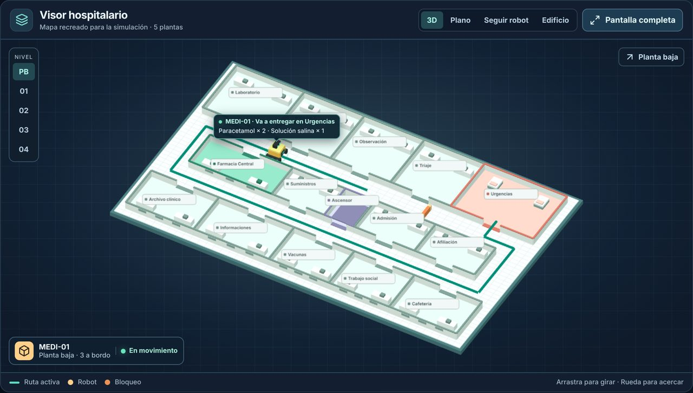
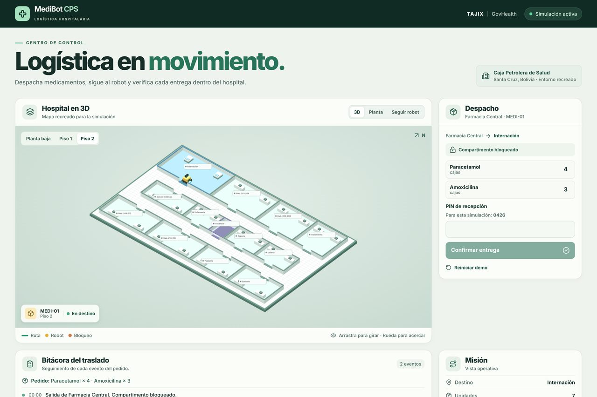
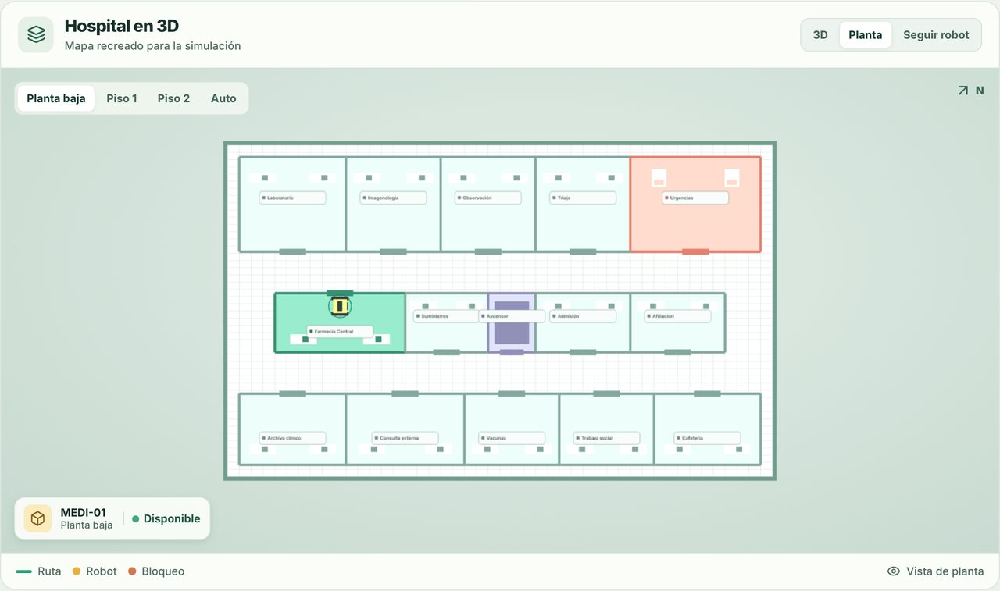
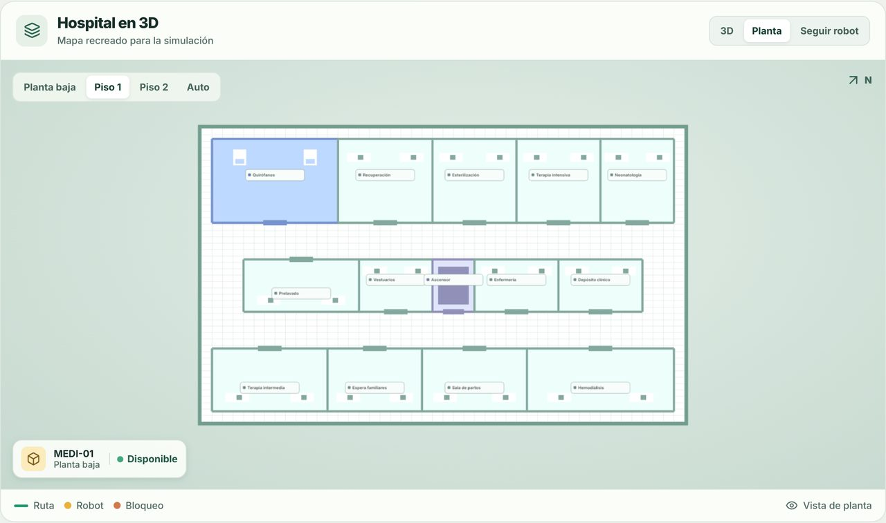

# Frente de presentación – Jorge
## MediBot CPS · Prototipo GovHealth – TAJIX

Este documento contiene el **guion oficial de presentación (pitch de 3 minutos)** para el jurado evaluador, la **guía reproducible paso a paso de la demo** y el **análisis de límites y métricas para un piloto real**. 

Cualquier persona o evaluador puede seguir y validar este proyecto **sin necesidad de conocer el código**.

---

## 1. Guion de Presentación para el Jurado (3 Minutos)

> **Regla de oro:** El prototipo se presenta bajo un marco riguroso de **hipótesis de trabajo**, destacando el potencial de optimización logística intrahospitalaria sin afirmar ahorros financieros o de tiempo que aún no hayan sido medidos empíricamente en campo.

```
0:00 ──────────────── 0:35 ──────────────── 2:15 ──────────────── 3:00 min
   [ Problema / Hipótesis ]    [ Demo en Vivo: Despacho/Desvío/PIN ]    [ Trazabilidad / Piloto ]
```

### Bloque 1: Problema y Contexto GovHealth (0:00 – 0:35)

* **Objetivo:** Plantear la problemática logística hospitalaria con realismo y humildad técnica.
* **Locución sugerida:**
  > *"Buenos días, miembros del jurado. En hospitales de alta demanda como los del sistema de seguridad social —inspiración de este prototipo basado en la Caja Petrolera de Salud de Santa Cruz—, el personal de enfermería y farmacia destina entre un 20% y 30% de su jornada a tareas mecánicas de traslado a pie de medicamentos y suministros críticos.*
  > 
  > *Nuestra hipótesis de trabajo con **MediBot CPS** es que un sistema de transporte autónomo intrahospitalario puede absorber la logística rutinaria entre plantas, reduciendo tiempos muertos y liberando al personal de salud para lo que realmente importa: la atención directa al paciente.*
  > 
  > *Aclaramos que hoy presentamos un prototipo funcional para validar la viabilidad técnica y operativa de navegación, contingencias y custodia de entrega, sin atribuirnos aún métricas de ahorro definitivas."*

---

### Bloque 2: Demostración en Vivo Integrada (0:35 – 2:15)

* **Objetivo:** Mostrar en vivo la resiliencia del robot, el recálculo dinámico de rutas y la confirmación de entrega.
* **Secuencia de acciones y locución simultánea:**

| Tiempo | Acción en Pantalla | Locución del Presentador |
|---|---|---|
| **0:35 – 0:55** | **Selección y Despacho:**<br>1. Seleccionar medicamento ficticio (ej. *Cefotaxima 1g*) y cantidad (ej. 3 unidades).<br>2. Definir destino: **Urgencias** (Planta Baja).<br>3. Clic en **Despachar robot**. | *"Iniciamos el ciclo en la Farmacia Central. El operador selecciona el fármaco prescrito y el destino: Sala de Urgencias. El robot asume la misión, carga el inventario y calcula la ruta óptima por el pasillo principal."* |
| **0:55 – 1:30** | **Simulación de Incidencia:**<br>1. Activar el botón **Bloquear pasillo** a mitad de camino.<br>2. Observar la detección inmediata del obstáculo y el aviso de *Ruta alternativa calculada*. | *"En un entorno hospitalario real surgen camillas, carritos o áreas en limpieza. Simulamos el bloqueo del pasillo central: el robot se detiene de forma segura, identifica la obstrucción y recalcula inmediatamente su trayecto hacia el anillo sur a través de los pasos de servicio, sin requerir asistencia humana."* |
| **1:30 – 1:55** | **Llegada y Custodia con PIN:**<br>1. El robot arriba a la estación de Urgencias.<br>2. Se abre el diálogo de seguridad.<br>3. Ingresar PIN demo: **`0426`**.<br>4. El compartimento se desbloquea y se registra la entrega. | *"Al llegar a Urgencias, el cargamento permanece bloqueado hasta que el personal receptor valida su identidad. Introducimos el PIN de prueba `0426`, se autoriza la recepción y el sistema registra al responsable de la entrega."* |
| **1:55 – 2:15** | **Retorno Autónomo a Base:**<br>1. El robot inicia el viaje de vuelta.<br>2. Regreso y acoplamiento en Farmacia Central. | *"Cumplida la entrega, el robot retorna de forma autónoma a Farmacia Central, quedando disponible de inmediato para una nueva orden o para subir a pisos superiores vía ascensor."* |

---

### Bloque 3: Trazabilidad, Límites y Piloto Real (2:15 – 3:00)

* **Objetivo:** Demostrar madurez técnica, honestidad sobre el alcance y claridad en los siguientes pasos.
* **Locución sugerida:**
  > *"Como pueden observar en el panel lateral, cada evento queda registrado en una **bitácora de auditoría en tiempo real**: tiempo de salida, telemetría, eventos de desvío y validación con PIN.*
  > 
  > *Es fundamental remarcar los **límites actuales del prototipo**:*
  > * *El hospital es un modelo recreado para simulación técnica, no un plano arquitectónico oficial.*
  > * *Los medicamentos son datos ilustrativos.*
  > * *El PIN de demo es un control funcional pedagógico, no una capa de ciberseguridad lista para producción.*
  > 
  > *¿Qué mediríamos en un **piloto real de campo** en la CPS? Tres indicadores clave:*
  > 1. ***Tiempo ciclo solicitud-entrega*** *comparado con el transporte manual.*
  > 2. ***Tasa de entregas autónomas exitosas*** *sin incidentes.*
  > 3. ***Tiempo de resolución y re-enrutamiento*** *ante pasillos congestionados.*
  > 
  > *MediBot CPS demuestra que la tecnología autónoma en salud pública es viable, segura y aplicable a nuestra realidad. Quedamos atentos a sus preguntas."*

---

## 2. Guía Reproducible de la Demo (Paso a Paso)

Esta guía permite a cualquier jurado, docente o desarrollador desplegar y evaluar el prototipo localmente en menos de 2 minutos.

### Requisitos Previos
* **Node.js:** Versión 24 o superior.
* **Navegador web moderno:** Google Chrome, Microsoft Edge, Firefox o Safari (con soporte WebGL habilitado).

### Puesta en Marcha Local
Ejecuta en tu terminal los siguientes comandos:

```bash
# 1. Instalar dependencias exactas
npm ci

# 2. Iniciar el servidor local de desarrollo
npm run dev
```

Abre en tu navegador la dirección indicada por la consola (habitualmente `http://localhost:5173`).

---

### Secuencia Reproducible de la Demostración

#### Escenario Principal: Entrega con Bloqueo y Recálculo Dinámico
1. **Verificar estado inicial:** Comprobar que en el visor 3D el robot se encuentra estacionado en **Farmacia Central** (Planta Baja).
2. **Configurar el pedido:**
   * Tipo de operación: **Entrega**.
   * Destino: **Urgencias** (Planta Baja).
   * Medicamento: Seleccionar cualquier insumo del catálogo ficticio y cantidad deseada.
3. **Despachar:** Hacer clic en el botón **"Despachar robot"**.
4. **Provocar contingencia (Desvío):**
   * Mientras el robot transita por el pasillo central, presionar el botón **"Bloquear pasillo"**.
   * Observar cómo el sistema emite el evento *"Ruta alternativa calculada"* y el robot toma el desvío por el paso sur.
5. **Completar entrega:**
   * Al detenerse el robot en Urgencias, ingresar el **PIN de prueba:** `0426`.
   * Presionar **"Confirmar recepción"**.
6. **Retorno:** El robot regresa automáticamente a Farmacia Central y la bitácora registra el ciclo como completado.

#### Escenario Secundario: Recorrido Multi-Planta
* Presionar el botón **"Probar recorrido – 5 plantas"** para observar el cambio de nivel mediante el ascensor hacia las plantas superiores (Piso 1 Quirófanos / Piso 2 Internación), verificando la coherencia espacial del edificio completo.

---

## 3. Capturas del Sistema Integrado

| Desvío ante Bloqueo hacia Urgencias | Navegación hacia Internación (Piso 2) |
|:---:|:---:|
|  |  |
| *Recálculo automático de ruta por anillo sur* | *Tránsito vertical y llegada a estación en planta alta* |

| Vista de Planta Baja (Área Crítica) | Vista de Piso 1 (Quirófanos / Terapia) |
|:---:|:---:|
|  |  |
| *Farmacia Central, Urgencias y anillo de circulación* | *Quirófanos, Terapia Intensiva y paso de ascensores* |

---

## 4. Matriz de Alcance y Límites del Prototipo

| Componente | Estado en el Prototipo actual | Alcance para Producción / Piloto Real |
|---|---|---|
| **Plano Hospitalario** | Entorno sintético 3D inspirado en la distribución funcional de la CPS Santa Cruz. | Relevamiento topográfico con planos arquitectónicos autorizados y nubes de puntos LiDAR. |
| **Insumos y Farmacia** | Catálogo simulado con propósitos de validación de volumen y destino. | Integración bidireccional vía FHIR / HL7 con el sistema ERP y farmacia del hospital. |
| **Mecanismo de Custodia** | Validación por PIN numérico fijo (`0426`) en interfaz táctil. | Lector NFC de credencial hospitalaria o autenticación biométrica de personal facultativo. |
| **Navegación y Sensores** | Algoritmo determinista de grafos ortogonales sobre nodos fijos con detección de bloqueos. | Fusión sensorial ROS 2 (LiDAR 2D/3D, SLAM visual y sensores ultrasónicos de parada de emergencia). |
| **Seguridad Física** | Simulación lógica de detención ante obstáculos. | Certificación de seguridad para transporte de material biológico y paradas certificadas ISO 13482. |

---

## 5. Métricas de Impacto para el Piloto en Campo

Para una fase de pilotaje experimental en un centro hospitalario de la CPS, se han definido los siguientes indicadores cuantitativos:

1. **Tiempo Medio de Ciclo de Entrega ($T_{ciclo}$):**
   $$\Delta T = T_{\text{entrega manual}} - T_{\text{entrega autónoma}}$$
   Medición del tiempo transcurrido desde la prescripción farmacéutica hasta la confirmación de recepción en el servicio receptor.
2. **Tasa de Autonomía de Misión ($TAM$):**
   $$TAM = \left( \frac{\text{Misiones completadas sin asistencia}}{\text{Total de misiones iniciadas}} \right) \times 100$$
   Evalúa la confiabilidad del enrutamiento y la frecuencia de contingencias operativas.
3. **Resiliencia ante Bloqueos ($T_{recup}$):**
   Tiempo promedio en segundos que toma el sistema en detectar una vía obstruida, recalcular la alternativa y retomar la velocidad nominal sin intervención humana.
